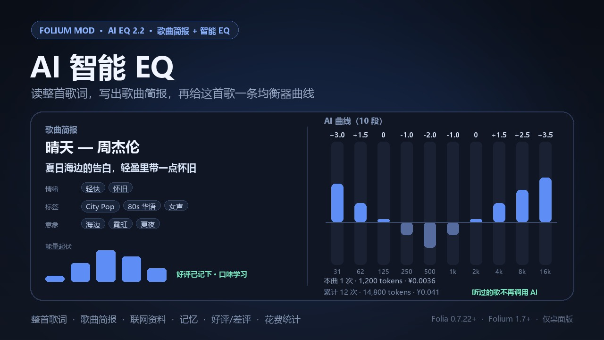

# AI 智能 EQ

> 让大模型读完整首歌词，**以曲风为主要判断依据**为每首歌调一条均衡器曲线，并写一份歌曲简报；听过的歌直接套用、不再调用 AI。




## 这是什么

Folia 是一款以全屏歌词为核心的桌面音乐播放器。这个模组会在你换歌时，把歌名、歌手和**整首歌词**发给你自己配置的 AI 服务商，让它：

1. 写一份**歌曲简报**：一句话概括、情绪、风格标签、歌词意象、能量起伏；
2. **先判定曲风**（流行 / City Pop / R&B / 摇滚 / 电子 / 嘻哈 / 爵士 / 抒情 / Lo-fi / 原声氛围），
   按这个曲风的音色策略定基调，再结合情绪与能量微调，给出一条 **10 段均衡器曲线**，校验后写进 Folia 的均衡器。
   曲风的权重高于历史口味；你在面板里手动改曲风后，旧曲线会自动作废并重新生成。

歌曲会被记住：同一首歌（同一套设置下）之后再播放，直接套用简报和曲线，**不再请求 AI、不再花钱**。你在面板里点的 👍/👎、在音效面板里手动切换音效，会被记成口味，之后遇到气质相近的歌会温和参考。

它**不上传音频**，不接账号，不跑中转服务器，没有遥测；API Key 用系统凭据库加密保存在本机。

## 功能

- **曲风驱动 EQ（v2.3.0）**：提示词按十类音色策略给出明确的频段范围（流行、City Pop/合成器流行、R&B、摇滚/金属、电子/舞曲、嘻哈/说唱、爵士/古典/原声、抒情慢歌、独立/Lo-fi、电影原声/氛围），先由曲风定基调，情绪与能量只做微调；面板显示「当前曲风：X（按某类策略调音）」，改曲风即重生成。
- **歌曲简报**：一句话概括、1–4 个情绪词、2–6 个风格标签、2–6 个歌词意象、4–8 段能量起伏（柱状图）。
- **联网资料（v2.2.0）**：可选先用「歌名 + 歌手」搜索创作背景/主题解读，把摘要放进提示词帮模型理解深层含义；支持 DuckDuckGo（免费）、Tavily、Serper/Google、博查 Bocha、自建 SearXNG，默认关闭，只发送歌名与歌手。
- **每首记忆**：简报 / 曲风 / 曲线 / token 花费按歌曲缓存，默认 30 天（可调），命中即秒生效、不调用 AI。
- **口味学习**：👍/👎、手动切换音效都会被记录；生成新歌时提示词里会带上"你喜欢的标签、常切音效、相近歌曲的反馈"。
- **播放页入口**：进度条右侧的 AI EQ 按钮 → 播放器面板「AI EQ」标签页：当前 EQ、歌曲标签、你的评价，一键生成 / A/B / 撤销。
- **调用与花费**：面板显示本曲与累计的调用次数、输入/输出 tokens、按你填的单价估算的花费。
- **安全边界**：失败静默；你手动改过音效后自动施加暂停（用户优先）；音频效果器窗口打开时曲线暂存、关窗补写；外部 Stage 播放时自动跳过。
- **OpenAI 兼容**：DeepSeek、OpenAI、Kimi、智谱 GLM、通义千问、豆包、本地 Ollama，或自定义兼容接口。

## 安装

### 从模组市场 / zip 安装

1. Folia：**设置 → 高级 → 模组**，打开「模组系统」（桌面版才有）。
2. 命令面板执行「模组」，把 `ai-eq-2.3.0.zip` 拖进面板；或解压到 `%APPDATA%\Folia\mods\ai-eq`。
3. 启用「AI 智能 EQ」，在原生确认窗口确认权限。
4. 展开模组 → 选择服务商、保存 API 密钥。

### 从源码构建安装包

```bash
node _tools/build-mod.mjs   # 源码在 _src/，生成单文件 ai-eq/client.mjs
node --test                 # 62 个 mock 宿主测试
```

需要 Node.js 24。仓库里 `ai-eq/` 就是可直接放进模组目录的成品；`_src/` 是源码，`_tools/build-mod.mjs` 负责打包成单文件（原因见下文"为什么只有一个 client.mjs"）。

## 配置

| 设置 | 说明 |
| --- | --- |
| 服务商 / 接口地址 / 模型 | 预设含常见 OpenAI 兼容服务；地址留空用预设，只允许 HTTPS（本机地址除外），自动补 `/chat/completions` |
| API 密钥 | 系统凭据库加密（Windows 走 DPAPI），不进日志、设置值或视觉配置导出 |
| 调整强度 | 温和 ±3 / 标准 ±6 / 明显 ±9 dB（宿主上限 ±12，相邻段再限 ≤3 dB 斜率） |
| 我的听感偏好 | 一句话，例如「耳机偏低频，希望人声靠前」 |
| 发送整首歌词 | 默认开，最多 6000 字；关闭后只用元数据，简报更粗糙也更便宜 |
| 联网资料 | 默认关闭。开启后先用歌名+歌手搜索创作背景/主题解读再生成；只发送歌名与歌手。可选 DuckDuckGo（免费）/ Tavily / Serper / 博查 / SearXNG |
| 搜索 API 密钥 / 地址 / 条数 | Tavily、Serper、博查需要密钥；SearXNG 填自建实例地址（需开启 JSON 输出）；条数 1–5 |
| 输入 / 输出价格 | 元 / 百万 tokens，用于估算花费 |
| 换歌时自动施加 | 关闭后只在你点「生成」时请求 |
| 记忆有效期 | 7 / 30 / 90 天 / 长期 |

## 使用

1. 播放一首歌：有记忆则直接套用，没有记忆则自动请求 AI（可在设置里关掉自动施加）。
2. 进度条右侧的 AI EQ 按钮 → 播放器面板「AI EQ」：看当前 EQ、曲风/情绪/标签/意象，点 👍/👎 记录评价。
3. 想对比：命令面板「AI EQ：A/B 对比」或面板里的按钮，在 AI 曲线和你的音效之间切换；「撤销 AI 曲线」立即回到你自己的音效。
4. 命令面板还有：为当前歌曲生成、测试 API 连接、清除歌曲记忆、重置口味学习、重置调用统计。

## 工作原理

```
换歌 ──▶ 歌名/歌手/专辑 + 整首歌词（≤6000字）+ 历史口味摘要
              │ 可选：先搜「歌名 + 歌手」拿创作背景/主题解读摘要
              │ 一次 chat/completions（JSON 输出）
              ▼
 genre（曲风 → 归类到十类音色策略，决定 EQ 基调）
 summary / meaning / emotion / tags / imagery / energy
 reason / curve[10] / confidence / usage(tokens)
              │
   校验：段数、±强度限幅、相邻 ≤3dB、置信度 <35% 不施加
              │
        applyCurve（宿主均衡器，用户优先）
              │
   写入记忆：简报 + 曲风 + 曲线 + 花费 ——▶ 下次直接套用，不再调用 AI
              │
   👍/👎、手动切换音效 ──▶ 口味记录 ──▶ 影响之后「气质相近」歌曲的提示词
```

提示词里的频段表来自宿主真实的 `equalizer.getState().bands`，宿主未来改段数也能兼容；模型输出只被当作数字与文本解析，解析失败直接丢弃，不会执行任何内容。

## 隐私、权限与安全

### 权限说明（发布审查用）

| 权限 | 用途 | 不做什么 |
| --- | --- | --- |
| `net.fetch` | 向**你自己配置的 AI 服务商**发 HTTPS 请求，请求体是歌曲元信息、歌词（可关）与口味摘要 | 不访问其它域名，不在本地起服务，不做中转/代理 |
| `equalizer.control` | 写入/撤下本模组的 EQ 曲线 | 不修改你的自定义音效栏位，不打开均衡器总开关（开关归你） |
| `filesystem.data` | 保存歌曲记忆、口味、统计与曲风（本模组数据目录） | 不上传、不读你的音乐文件 |

- 发送给 AI 的只有：歌名、歌手、专辑、整首歌词（≤6000 字，可关）、你填的听感偏好、口味摘要（标签/模式名）。
- 开启「联网资料」时，搜索查询只包含**歌名与歌手**（不含歌词），发给你选择的搜索服务；默认关闭，失败不影响出曲线。
- **不发送**：音频、账号、Cookie、设备信息、听歌历史列表。
- API 密钥由系统凭据库加密保存，不写入日志，不进入视觉配置导出。
- 非 HTTPS（本机地址除外）会在发送密钥前被拒绝。
- 模组是单文件 `client.mjs`，**没有 main 入口**、没有 `eval`、不下载/执行远程代码、无遥测。

## 兼容性

- Folia 桌面版 **0.7.22+**（Folium **1.7+**），用到的都是稳定接口：`folium.equalizer`、`folium.secrets`、`folium.net.fetch`、`folium.storage`、`folium.lyrics`、`progressButtons`、`playerPanelTabs`。
- 仅桌面版；网页版 / PWA 没有模组系统。
- 外部 Stage 播放时均衡器不作用，模组会保留曲线并提示；均衡器总开关关着时曲线会写入但听不到。

## 已知限制

- 大模型**听不到声音**：简报与曲线是根据文字推断的，不是声学测量，同一首歌换模型结果会不同。
- 歌词可能不完整；没有歌词时简报会注明"推断"，质量下降。
- 宿主均衡器只有 10 段 / ±12 dB。
- token 与花费是估算值（按你填的单价、以服务商返回的 usage 为准）。

## 常见问题

| 现象 | 处理 |
| --- | --- |
| 找不到「模组」命令 | 先确认「设置 → 高级 → 模组」的模组系统已开启 |
| 提示没有 API 密钥 | 展开模组设置粘贴密钥并保存；本机 Ollama 可留空 |
| 401 / 403 / 404 / 429 | 密钥、模型名、接口地址或额度问题；面板里能看到当前接口 |
| 413 请求太大 | 关闭「发送整首歌词」，或换上下文更大的模型 |
| 同一首歌又请求 AI | 改过模型/强度/偏好/歌词开关（记忆按这些参数分开）、记忆过期，或手动点了生成 |
| 改了曲风后曲线也变了 | 设计如此：曲风是 EQ 的主要依据，旧曲线按旧曲风生成，改曲风后自动作废并重新生成 |
| 换音效后不再自动调 | 设计如此：自动施加暂停，重新打开「换歌时自动施加」 |
| 想重置口味 / 统计 | 命令面板「AI EQ：重置口味学习 / 重置调用统计」 |

## 开发与测试

```bash
_src/eq.mjs        # 纯逻辑：供应商预设、端点校验、提示词、JSON 解析、曲线归一化
_src/client.mjs    # 宿主交互：面板、命令、事件、记忆、口味、统计、施加
node _tools/build-mod.mjs   # 打包成单文件 ai-eq/client.mjs
node --test                 # 50 个 mock 宿主测试
```

**为什么只有一个 client.mjs**：Folium 只给 client 入口的 URL 加 `?v=<内容指纹>`，入口里的相对导入解析出的 URL 不带指纹，会被浏览器按 URL 缓存旧模块（更新后可能报 `does not provide an export named …`）。打包成单文件后没有任何相对导入，从根上避免这个问题。

## 目录结构

```
ai-eq/            # 可直接安装的成品（mod.json + 单文件 client.mjs + preview + README + LICENSE）
_src/             # 源码（eq.mjs / client.mjs）
_tests/           # mock 宿主 + 50 个测试
_tools/           # build-mod.mjs 打包脚本、清单自检、预览图脚本
```

## 许可证与致谢

MIT。接口校验与「服务商预设 + 自动补 `/chat/completions`」的思路参考了社区模组 [song-info](https://github.com/folium-mods/song-info)（MIT），实现为独立代码；播放页入口（进度条按钮 + 播放器面板标签页）的交互方式也参照了该模组的做法。Folia / Folium 的接口规范见 [chthollyphile/folia-major](https://github.com/chthollyphile/folia-major)。
